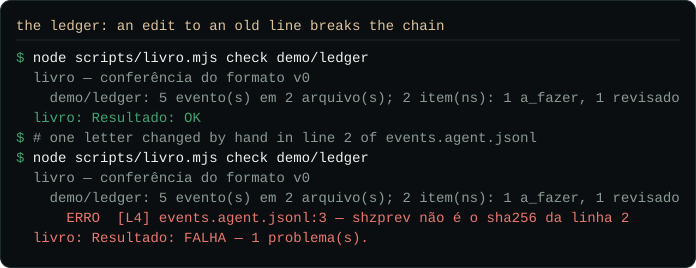

<div align="center">


# Shizune

**Auditable decision governance for work done with AI agents.**

The machine drafts. You sign. The command verifies.

[](https://github.com/CaduAzeredo/shizune/blob/main/LICENSE)
[](https://github.com/CaduAzeredo/shizune/actions/workflows/ci.yml)
[](https://github.com/CaduAzeredo/shizune/releases/latest)
[](#no-install-step)
[](https://shizune.dev)

**[shizune.dev](https://shizune.dev)** · [Quickstart](https://github.com/CaduAzeredo/shizune/blob/main/QUICKSTART.md) · [Threat model](docs/THREAT-MODEL.md) · [Discussions](https://github.com/CaduAzeredo/shizune/discussions)

</div>

## What it checks

A decision is one numbered row in `governance/registro-decisoes.md`: the id, what was decided, a status, who signed it, the SHA of the commit in which it was signed, and a seal over all of that. A commit that relies on a decision says so in a trailer:

```text
Decision: DEC-002
```

`scripts/validate-decisions.mjs` reads every trailer in the history and fails the build when the decision it cites does not exist, is still a draft, has no signer, or points to a SHA that does not resolve. It also fails when a decision number appears on two rows, and when a signed row no longer matches its seal. When your repository declares it, the check also fails when the signing commit has no good signature from a key in your `.github/allowed_signers`, or when it was signed by a key you marked as a machine's.


The picture is real output. It is regenerated by a script that runs the four steps in a throwaway repository with two keys made on the spot; the lines about the other checks are left out.

## Check it yourself

You need git and Node 20 or newer, or Bun. The negative tests build the same kind of throwaway repository, with keys of their own, and fail the cases above on purpose:

```bash
git clone https://github.com/CaduAzeredo/shizune.git && cd shizune
git checkout "$(git tag --sort=-v:refname | head -1)"
node scripts/test-validate-decisions.mjs
```

## What a signature does not prove

Read this before you rely on the check. The full list, with how to reproduce each item, is in the [threat model](docs/THREAT-MODEL.md).

- **It shows which key signed, not who decided.** A passphrase on the key adds the presence of whoever holds it, and nothing else.
- **A wrong decision signed with the right key passes.** The check knows a decision was signed; it cannot know the decision was good.
- **A compromised key, CI runner or machine passes whatever it signs.**
- **What is signed is a commit, not the row.** The seal catches a change to a signed row that did not redo the seal, not one that rewrote both; a row signed before seals existed has none; and a commit signed by a machine key can add a signed row that points to a commit you signed.

## The ledger

The ledger tracks work items through a fixed set of situations, with proof. Each actor writes to its own file, one event per line; each line is a CloudEvents event in canonical JSON, chained to the line before it by its SHA-256. Nothing is edited: the current state is recomputed from the events every time. And "signed" is never written by anyone. It is derived: an item counts as signed when the commit it was reviewed at carries a good signature from a key you declared human.

```bash
node scripts/livro.mjs check path/to/ledger          # bytes, canonical form, chain, actors, transitions
node scripts/livro.mjs rebuild path/to/ledger        # recompute the projection
node scripts/livro.mjs append path/to/ledger --actor <principal> --type item --item <id> --titulo "<title>"
```



The chain catches an edit made after a line was written. It does not catch a line that was false when it was written: the hash seals what it is given.

## No install step

The framework has **zero dependencies**: there is no `package.json`, and the scripts import nothing but the runtime's builtins. You need **Bun** or **Node.js 20+**, and **git** (2.34 or newer, to verify SSH signatures).

```bash
git clone https://github.com/CaduAzeredo/shizune.git && cd shizune
bun scripts/doctor.mjs                 # or: node scripts/doctor.mjs — runs every check, never writes
bun scripts/new-project.mjs my-project # scaffold a project
```

Full walkthrough in the [Quickstart](https://github.com/CaduAzeredo/shizune/blob/main/QUICKSTART.md).

> **Language.** This README, the quickstart, the agent contract, the contributing guide and the worked example are in English. `skills/`, `templates/` and the frontmatter field names (`tipo`, `projeto`, `data`, `autor`) are still in Brazilian Portuguese, and the validators print in Portuguese; the translation is tracked in the [translation issue](https://github.com/CaduAzeredo/shizune/issues/new?template=translation.yml), with no date.

## What is in the package

<details>
<summary>The file tree, generated from the public inventory of this release</summary>

<!-- arvore:inicio -->
```text
.
├── .github/
│   ├── ISSUE_TEMPLATE/
│   │   ├── bug_report.yml
│   │   ├── config.yml
│   │   ├── skill_proposal.yml
│   │   └── translation.yml
│   ├── workflows/
│   │   └── ci.yml
│   └── PULL_REQUEST_TEMPLATE.md
├── docs/
│   ├── assets/
│   │   ├── decisao.svg
│   │   ├── livro.svg
│   │   ├── pipeline.svg
│   │   └── shizune-glifo.svg
│   ├── SUCCESSION.md
│   └── THREAT-MODEL.md
├── examples/
│   └── course-platform-demo/
│       ├── handoffs/
│       │   ├── handoff-lumina-round-2.json
│       │   └── handoff-lumina-round-2.md
│       ├── specs/
│       │   └── spec-002-certificate-issuance.md
│       ├── tickets/
│       │   ├── ticket-001-certificate-issuance.md
│       │   └── ticket-002-certificate-reissuance.md
│       ├── CONTEXT.md
│       ├── DOMAIN.md
│       └── audit-and-governance-journey.md
├── governance/
│   ├── registro-decisoes.md
│   └── registro-projetos.yaml
├── references/
│   └── README.md
├── scripts/
│   ├── build-checklist.mjs
│   ├── build-index.mjs
│   ├── checar-nome.sh
│   ├── doctor.mjs
│   ├── export-manifest.json
│   ├── export-public.mjs
│   ├── ficha-release.mjs
│   ├── link-skills.ps1
│   ├── livro.mjs
│   ├── new-project.mjs
│   ├── redaction-patterns.example.json
│   ├── rodada-noturna.mjs
│   ├── test-build-index.mjs
│   ├── test-doctor.mjs
│   ├── test-ficha-release.mjs
│   ├── test-livro.mjs
│   ├── test-rodada-noturna.mjs
│   ├── test-validate-decisions.mjs
│   ├── validate-decisions.mjs
│   ├── validate-links.mjs
│   ├── validate-prose-refs.mjs
│   ├── validate-state.mjs
│   └── validate-structure.mjs
├── skills/
│   ├── core-pipeline/
│   │   ├── domain-modeling/
│   │   │   └── SKILL.md
│   │   ├── grill-with-docs/
│   │   │   └── SKILL.md
│   │   ├── handoff/
│   │   │   └── SKILL.md
│   │   ├── implement/
│   │   │   └── SKILL.md
│   │   └── to-spec/
│   │       └── SKILL.md
│   ├── meta/
│   │   └── writing-for-agents/
│   │       └── SKILL.md
│   ├── ops/
│   │   ├── shizune-adr/
│   │   │   └── SKILL.md
│   │   └── shizune-rodada/
│   │       └── SKILL.md
│   └── README.md
├── templates/
│   ├── projeto/
│   │   ├── CONTEXT.md
│   │   └── DOMAIN.md
│   ├── skill/
│   │   └── SKILL.md
│   ├── adr.md
│   ├── handoff.json
│   ├── handoff.md
│   ├── launch-checklist.md
│   ├── relatorio.md
│   ├── retorno-de-sessao.md
│   ├── spec.md
│   ├── status.md
│   └── ticket.md
├── .gitattributes
├── .gitignore
├── AGENTS.md
├── CHANGELOG.md
├── CODE_OF_CONDUCT.md
├── CONTRIBUTING.md
├── LICENSE
├── NOTICE
├── QUICKSTART.md
├── README.md
└── SECURITY.md
```
<!-- arvore:fim -->

</details>

| Part | What it is |
| --- | --- |
| `scripts/` | The checks (`doctor.mjs` runs all of them), the decision validator, the ledger, the scaffolder and the export |
| `skills/` | The development pipeline: `grill-with-docs` → `domain-modeling` → `to-spec` → `implement` → `handoff`, plus the `writing-for-agents` meta-skill and the operations skills |
| `templates/` | ADR, spec, ticket, status, handoff and the project skeleton |
| `governance/` | An empty decision registry and the project registry, for your instance to fill |
| `examples/` | A synthetic project taken through the whole pipeline, with one ticket deliberately blocked |
| `AGENTS.md` | The operating contract an agent reads before it acts |

## Does anything leave your machine?

No. There is no telemetry, no analytics, no phone-home and no account, and nothing is fetched at run time. Check it rather than trusting the paragraph:

```bash
grep -rn "fetch(\|node:http\|node:https\|node:net\|node:dns" scripts/*.mjs
```

`scripts/checar-nome.sh` is the exception, and it says so: a name-and-domain availability checker that queries RDAP and DNS. `doctor.mjs` never calls it; it runs when you run it, and it sends the name you asked about.

## Evidence

This project holds itself to the rule it asks of you: a number that was not measured is not published. The notes of the [latest release](https://github.com/CaduAzeredo/shizune/releases/latest) cite, next to each number, the command that reproduces it, and the release card attached to the same release, shizune-release.json, records the SHA and the date each claim was measured on. Client work done with the framework is not described here, in any form.

## Using this commercially

The framework is free under Apache 2.0 and stays that way: fork it, run it inside a company, build on it. If you want the method applied rather than adopted, that is a conversation, not a checkout page: start at **[caduazeredo.com](https://www.caduazeredo.com/)** or open a [discussion](https://github.com/CaduAzeredo/shizune/discussions). There is no published price list.

## If this project stops

One person maintains it. There is no company behind it, no support contract and no service level. The artifacts are Markdown and git: your decisions, contexts and records stay readable with no tool of ours. The scripts are Apache 2.0 with zero dependencies, so a fork needs nothing but a runtime. What happens if the maintainer goes quiet, where the signing key is and how a fork declares itself a continuation: [succession](docs/SUCCESSION.md).

## Trademark and naming

The composite **Shizune — by Cadu Azeredo** identifies this project and its origin. Apache License 2.0 grants patent and copyright rights; section 6 grants no trademark rights. The code is free under the licence; the name and visual identity are not licensed with it. A fork must not present itself under the composite name or imply endorsement; describing your work as *"built with Shizune"* is welcome and needs no permission. "Shizune" is a common word in this space, and this project is the one at `CaduAzeredo/shizune`.

## License

Apache License 2.0 — Shizune © 2026 Cadu Azeredo. See [LICENSE](https://github.com/CaduAzeredo/shizune/blob/main/LICENSE) and [NOTICE](https://github.com/CaduAzeredo/shizune/blob/main/NOTICE).
